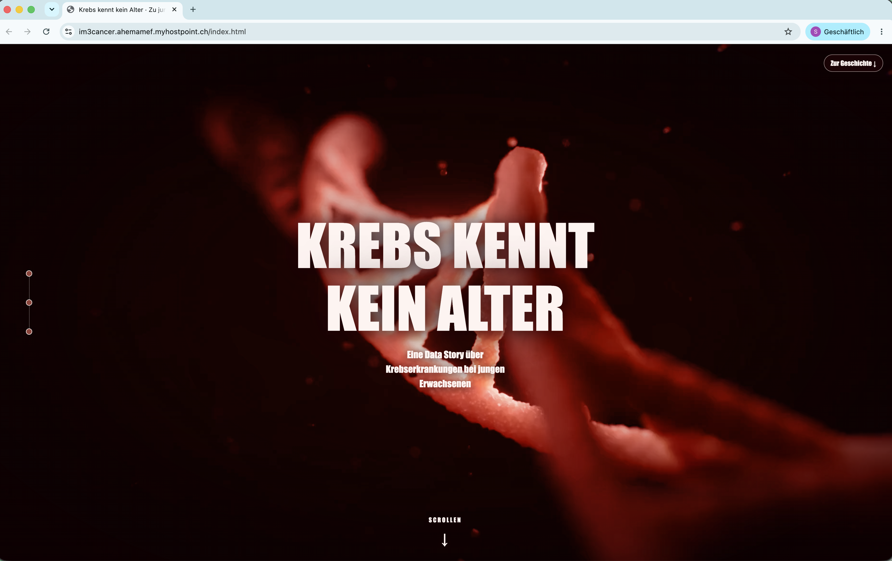
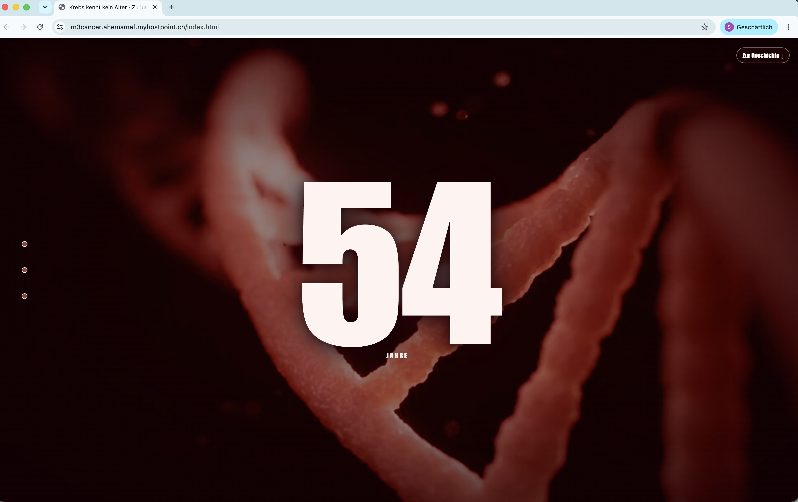
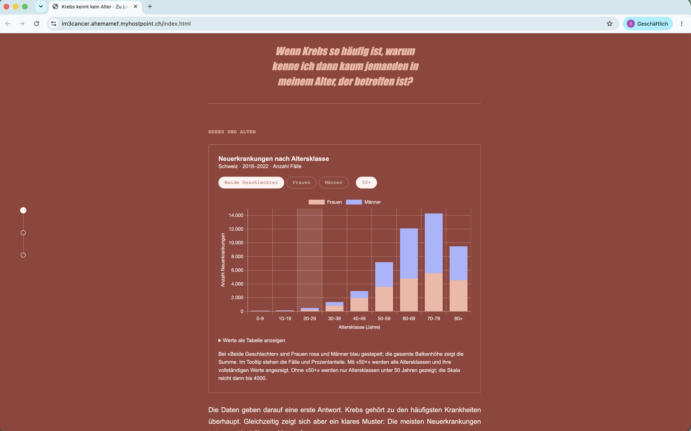
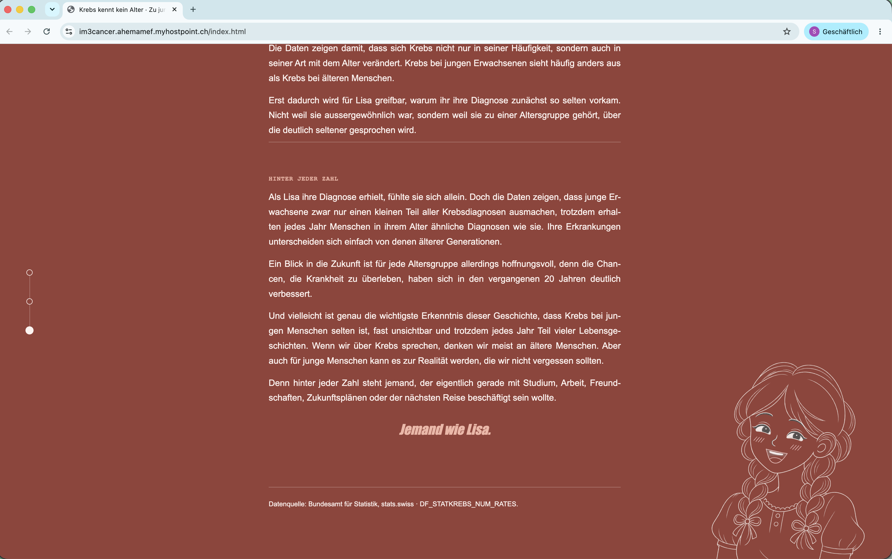
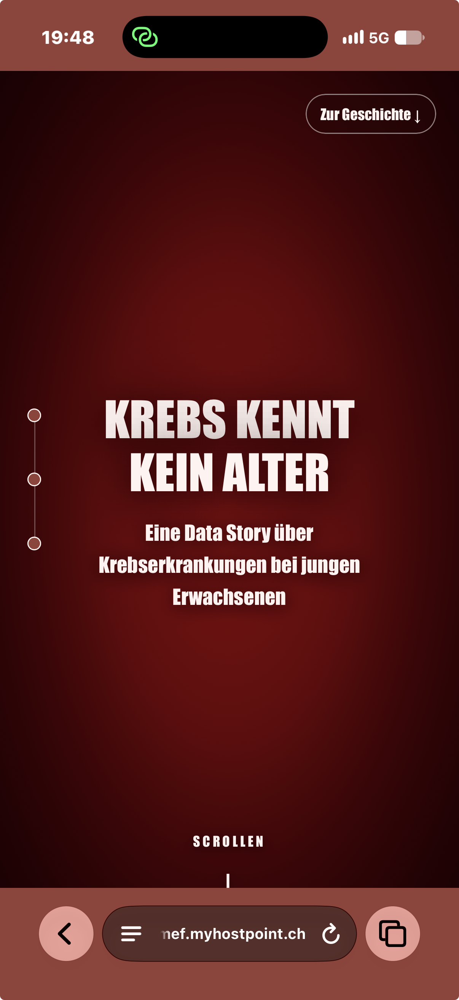
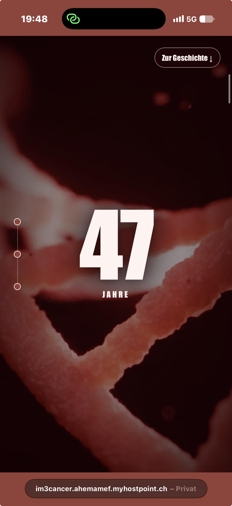
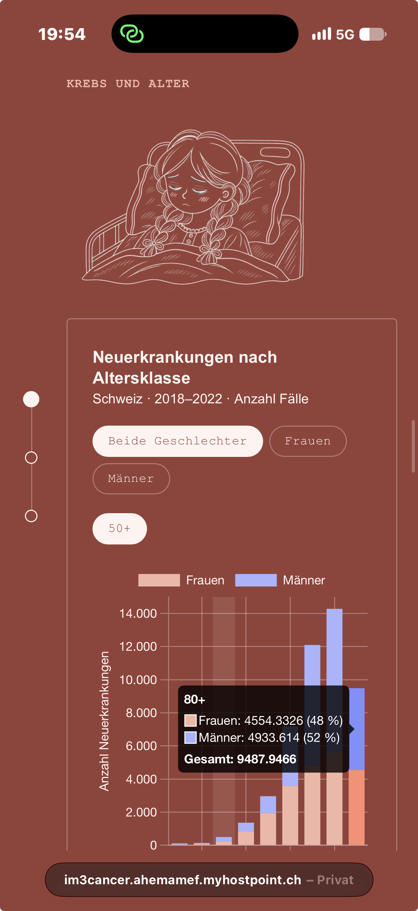
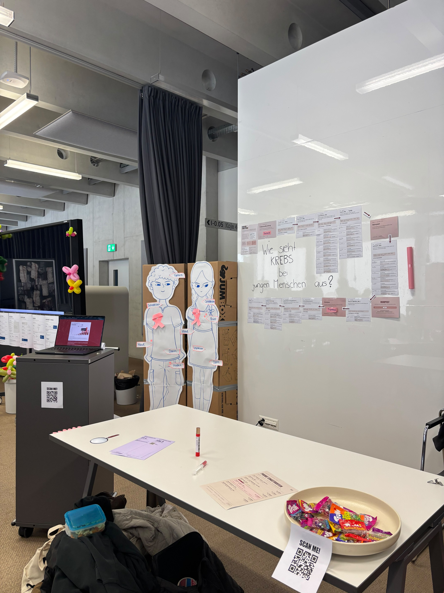
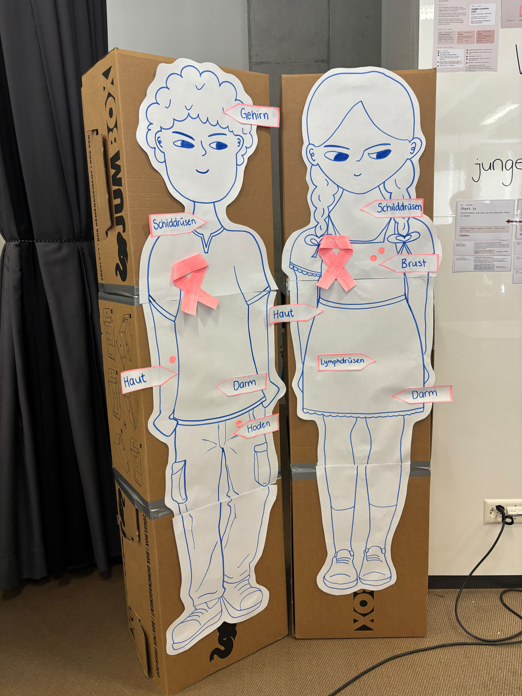
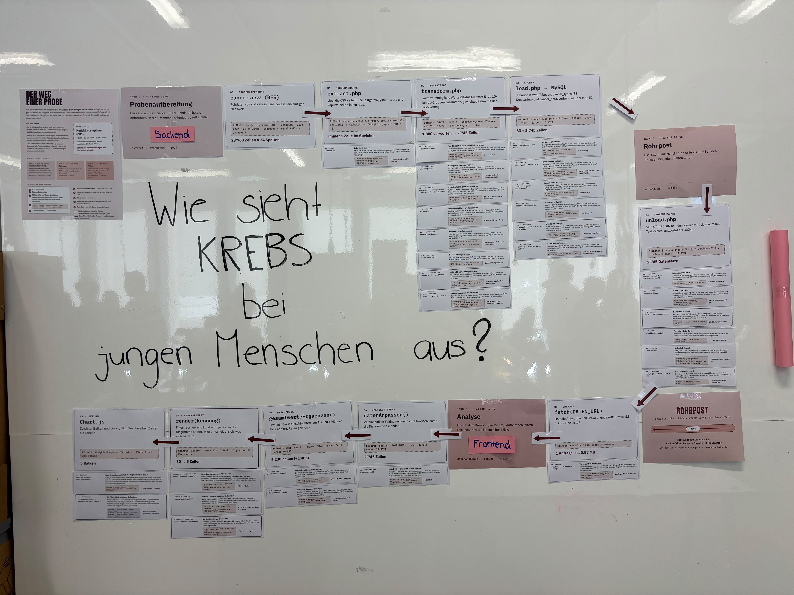

## Zu jung dafür?

## Projektidee / Kurzbeschreibung

«Zu jung dafür?» ist eine Data Story über Krebserkrankungen bei jungen Erwachsenen in der Schweiz und ist im Rahmen des dritten Semester des Moduls interaktive Medien entstanden. Lisas Geschichte führt durch drei interaktive Grafiken: Neuerkrankungen nach Alter, die Entwicklung von Neuerkrankungs- und Sterberaten sowie häufige Krebsarten bei 20- bis 29-Jährigen. 
## Datengrundlage
Unsere Datensätze sind Krebsdaten des Bundesamts für Statistik: https://stats.swiss/vis?lc=de&df%5Bds%5D=disseminate&df%5Bid%5D=DF_STATKREBS_NUM_RATES&df%5Bag%5D=CH1.STATKREBS&df%5Bvs%5D=1.0.0&dq=1.28%252B0.1%252B2%252B_T.2018.Y20T24%252BY25T29.1%252B2.200%252B1000&to%5BTIME%5D=false&vw=tb

## Learnings (Backend)
Wir haben verstanden, dass KI prompten sehr hilft, jedoch wichtig ist, dass wir den Inhalt verstehen und der künstlichen Intelligenz nicht einfach blind vertrauen. 
Ein weiteres Learning war, dass wir im Vorhinein wissen mussten, was für Daten man für eine Datengeschichte braucht und wieso. Visualisierungen auf Papier vor der Datentransformation haben uns daher sehr weitergeholfen.
Ausserdem hat uns der Wert der Anzahl Fälle verwirrt, da er  Kommastellen beinhaltete. Wir haben schlussendlich jedoch herausgefunden, dass es sich bei dem Wert um einen Durchschnittswert einer Zeitperiode von fünf Jahren handelt.
Wir haben nicht damit gerechnet, was für eine Auswirkung es hatte, dass wir unsere Altersgruppen zusammengefasst haben (in unserem sortierten Datensatz waren das jeweils 5 Jahre zusammengefasst, wir wollten 10 Jahre zusammengefasst darstellen) Bei der Inzidenz- und Mortalitätsrate mussten wir die Anzahl Bevölkerung zurückrechnen, da die verschiedenen Altersgruppen verschiedene Raten hatten und man Rate nicht einfach summiert werden können wie beispielsweise die Anzahl Fälle. Anhand der Anzahl Fälle und der Anzahl Raten wurden die benötigten Bevölkerungszahlen geschätzt, um die Raten der von uns definierten Altersgruppen zusammenlegen zu können. 
Ausserdem mussten wir Schlüssel nutzen, um unseren Datensatz zu gruppieren. So wurde es weniger komplex.
Im CSV Datensatz in der Spalte OBS_Status stehen folgende Werte: M, A und E. M steht für fehlender oder nicht existierender Wert (beispielsweise Eierstockkrebs bei Männern). Die Bezeichnung E steht für geschätzter Wert. Diesen haben wir bewusst dringelassen (dabei kann es sich beispielsweise um einen hochgerechneten Mittelwert über einen gewissen Zeitraum handeln). Beim Status A handelt es sich um einen normalen Wert. Deswegen haben wir alle Zeilen in unserem Datensatz, die den Status M enthalten, am Anfang der Hauptschleife aussortiert.

## Learnings (Frontend)
Beim Frontend haben wir gelernt, dass eine Datengeschichte mehr braucht als anschauliche Grafiken. Die Informationen müssen so angeordnet sein, dass man der Geschichte gut folgen kann. Auf unserer Website führt Lisas Geschichte Schritt für Schritt zu den drei Grafiken über Krebs nach Altersgruppe, den zeitlichen Verlauf und die häufigsten Krebsarten. Dabei war es wichtig, die interaktiven Filter verständlich zu gestalten und Farben, Achsen und Kennzahlen direkt zu erklären. Ein weiteres Learning war, dass Text, Gestaltung und Daten eng zusammenpassen müssen. Die Aussagen in der Geschichte sollen sich in den Grafiken wiederfinden und verständlich belegt werden.

## Schwierigkeiten (Backend)
Da wir mit sehr grossen Datenmengen arbeiteten, hatte der Arbeitsspeicher des PHP Servers nicht genug Speicherplatz und konnte die Daten nicht ausgeben. Dafür haben wir einen PHP-Generator (mit yield) programmiert, um den Speicher nicht zu überlasten.
Im Transform haben wir die 4 Einzelzeilen (Rate/Fälle für Inzidenz und Mortalität) sowie die 5-Jahres-Gruppen zu einer einzigen Zeile zusammengefasst. So konnten wir den Datensatz reduzieren und vereinfachen (8 Zeilen wurden zu einer).
Unser Wert "Alle Krebsarten (total) (C00-C97*)" wurde in unserem Datensatz nicht gefunden, auch wenn er vorhanden und in unserem Code richtig geschrieben war. 
Aus diesem Grund haben wir es folgendermassen gelöst: Unser Code überprüft, ob der Text mit den Wörtern "Alle Krebsarten" beginnt, egal was danach kommt und dieser der Gesamtkategorie zuweist. Worin der Fehler genau bestanden hat (beispielsweise fehlendes Leerzeichen), konnten wir nicht herausfinden.

## Schwierigkeiten (Frontend)
Eine Schwierigkeit bei der Gestaltung des Frontends war, die Interaktivität und Spannung über die ganze Website hinweg aufrechtzuerhalten. Der Einstieg war sehr interaktiv und setzte dadurch hohe Erwartungen. Im Vergleich dazu wirkten die unteren Abschnitte zunächst etwas ruhiger und weniger spannend. Um die Geschichte bis zum Schluss lebendig zu halten, haben wir passende Animationen von Lisa ergänzt. Dabei war es wichtig, dass die Animationen zur jeweiligen Stelle der Geschichte passen und die Inhalte unterstützen.

## Datenlimitationen
Wir haben die prozentuale Anzahl der Erkrankungen im Vergleich zur gesamten Schweizer Bevölkerung bewusst nicht in unseren Grafiken ausgegeben. Grund dafür ist, dass wir dafür einen zweiten Datensatz gebraucht hätten mit den richtigen Bevölkerungsanzahl der jeweiligen Jahre. In unserem transform kann nur anhand der Krebsfälle und der Erkrankungsrate die Bevölkerungszahl geschätzt werden. Darauf wollten wir uns aber nicht verlassen.

## Benutzte Ressourcen
Datenquelle: https://stats.swiss/vis?lc=de&df%5Bds%5D=disseminate&df%5Bid%5D=DF_STATKREBS_NUM_RATES&df%5Bag%5D=CH1.STATKREBS&df%5Bvs%5D=1.0.0&dq=1.28%252B0.1%252B2%252B_T.2018.Y20T24%252BY25T29.1%252B2.200%252B1000&to%5BTIME%5D=false&vw=tb
Videoquelle: https://pixabay.com/videos/dna-helix-deoxyribonucleic-acid-6973/
Tools: KI Prompting (Claude, Gemini und ChatGPT)

## Screenshots Desktop-Ansicht

## Screenshot Mobile-Ansicht

## Foto unseres Marktstands

